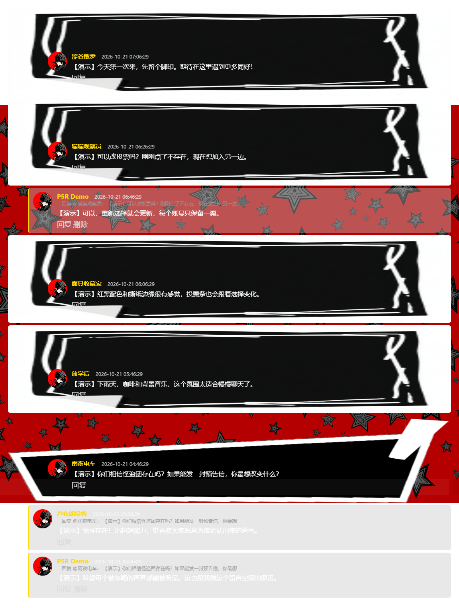
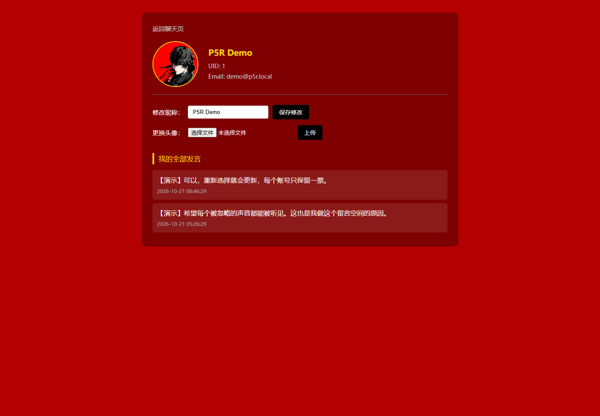

# P5R · 怪盗留言板

以《女神异闻录 5》视觉风格为灵感的 PHP + MySQL 互动留言项目。通过主题投票、留言回复与个人资料页，为同好提供一个交流空间。

## 界面预览





截图中的账号、评论和投票均为演示数据，不代表真实访问或用户规模。

## 功能

- 邮箱注册、密码哈希验证、Session 登录。
- “怪盗团是否存在”投票，每个账号保留一票，支持修改选择和比例统计。
- 发表留言、回复、本人留言删除；管理员判断逻辑。
- 修改昵称、上传头像、查看自己的留言。
- 红黑主题、p5.js 星形背景动画、加载过渡页面。

## 本地运行

需要 PHP（mysqli、mbstring 扩展）和 MySQL。此副本已在 PHP 7.0.11 / MySQL 5.7.15 上本地验证；原 Workbuddy 版本的 Cookie 参数和 void 返回声明做了兼容处理。现代 PHP 环境仍需按实际部署验证。

1. 在 MySQL 中建立专用数据库和账号，例如数据库 `p5r_demo`，字符集 `utf8mb4`。
2. 设置环境变量 `DB_HOST`、`DB_USER`、`DB_PASSWORD`、`DB_NAME`。`.env.example` 仅是变量清单，PHP 不会自动读取 `.env`。
3. 在项目根目录运行：

```sh
php init_database.php
php scripts/seed-demo.php
php -S 127.0.0.1:8094 -t .
```

打开 http://127.0.0.1:8094/login.php 。演示账号 `demo@p5r.local`，演示密码 `P5rDemo123`。这些是专门生成的演示账号，与数据库账号无关。

Windows PowerShell 可用 `$env:DB_NAME='p5r_demo'` 等方式设置当前进程环境变量；数据库密码请自行在本机填写。生产环境不要导入演示账号。

`init_database.php` 只允许 CLI 执行，创建 users、admins、messages、votes 四张表。`scripts/seed-demo.php` 只允许 CLI 执行，可重复运行；只应对专用演示数据库使用，不向 admins 表自动添加管理员。

## 文件与数据

- `config/config.php`：读取环境变量，仓库不包含数据库密码。
- `scripts/seed-demo.php`：生成 7 个演示账号、8 条留言和回复、7 票。
- `docs/screenshots/`：登录、首页、投票、留言、个人页截图。
- `uploadPic/`：仅保留项目默认头像，不包含历史用户上传资料。
- 本地旧数据库、数据库备份、开发工具记录均未上传。

投票图片使用英文文件名，避免旧 Windows PHP 服务对中文静态路径的兼容问题。p5.js 1.9.0 依赖保存在 js/p5.min.js，原许可信息保留在文件头。

## 部署与素材

GitHub 仓库用于源码展示；GitHub Pages 不能运行 PHP / MySQL。完整线上交互需要另行部署 PHP 与数据库，本仓库不包含公网后台。

这是个人学习与作品展示项目。P5R 相关角色、音乐及游戏视觉素材的权利属于各自权利人；仓库未对这些第三方素材授予再分发或商业使用许可。
